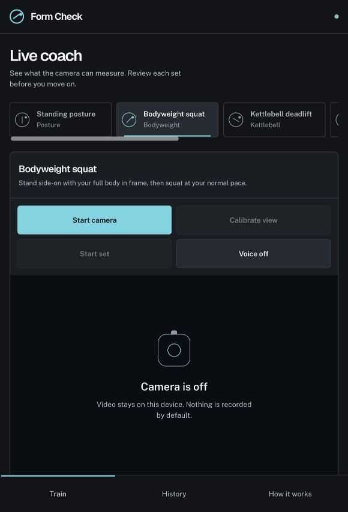
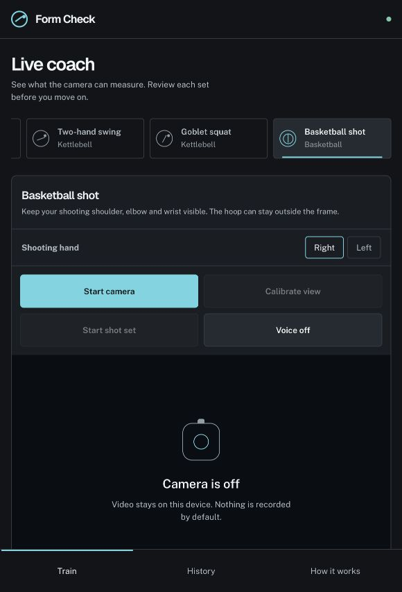

# Narrow-screen setup review

Captured 2026-10-26 from the running local Form Check preview. Camera permission was not requested and no live workout was performed.

## 1. Squat setup — needs work

- Strength: clear title, high-contrast primary Start camera button, restrained dark colors.
- Friction: six movement cards create a clipped horizontal strip; browser scrollbar appears. Four same-sized controls precede the camera, but three are unavailable or secondary. The coaching cue and measurements begin below the visible screen.
- Accessibility risk: small gray helper text may be hard to read at arm's length; the horizontal mode selector needs keyboard and screen-reader verification. Screenshot alone does not establish contrast or focus behavior.

## 2. Basketball setup — needs work

- Strength: shooting-hand choice is visible; the app accurately says current basketball mode does not track ball/rim in its measurements area.
- Friction: selecting Basketball scrolls the movement strip to its end, so the active choice and previous choices appear in a crowded row. Setup copy permits the hoop to be outside frame; that fits current arm-only mode but must change when release/path is implemented. The empty camera icon carries no placement guidance.
- Accessibility risk: Right/Left selections and live tracking state need a larger touch target and clear spoken labels in the final phone flow. That cannot be confirmed from this static screen.

## Priority

Move the video preview ahead of secondary controls, make the current practice mode explicit without a six-item strip, and show one enabled next action. Then add measured overlay/unknown states and purposeful camera-placement illustrations. Review a live and completed-session state when phone access is available.
